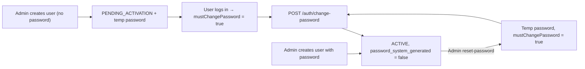
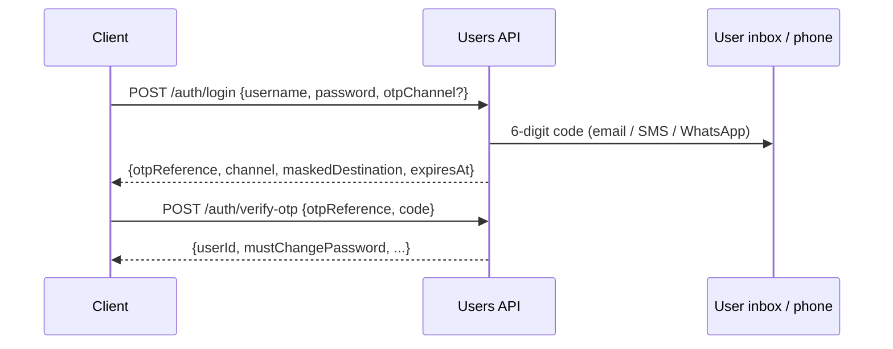

# Users API (`usersapi`)

Spring Boot service for managing Swizima system users and authentication.

- **Base package:** `com.swizima.usersapi`
- **Tech stack:** Java 21, Spring Boot 4.1.2 (Web MVC, Data JPA, Validation), PostgreSQL, Lombok, springdoc-openapi (Swagger), BCrypt (`spring-security-crypto`)
- **Port:** `8085` · **Swagger UI:** http://localhost:8085/swagger-ui.html

## Package structure

```text
com.swizima.usersapi/
├── config/        # JpaAuditingConfig, PasswordEncoderConfig, OpenApiConfig
├── controller/    # SystemUserController, AuthController
├── dto/           # Request/response records, PasswordPolicy, PageResponse
├── entity/        # ParentEntity, SystemUser
│   └── enums/     # ActivationStatus, UsernameType, RecordStatus
├── exception/     # Domain exceptions + GlobalExceptionHandler
├── repository/    # SystemUserRepository
├── service/       # SystemUserService, AuthService (+ impl/)
├── util/          # UsernameNormalizer, PasswordGenerator
└── UsersapiApplication.java
```

## Username: email or phone number

A single `username` column holds **either** an email or a phone number, plus a `username_type` column (`EMAIL` / `PHONE`) that is detected automatically.

Usernames are **normalised** before saving and before every lookup, so they stay unique and login works however the user types them:

| Input | Stored as | Type |
|---|---|---|
| `Jane.Doe@Mail.com` | `jane.doe@mail.com` | `EMAIL` |
| `0700 123 456` | `+256700123456` | `PHONE` |
| `256700123456` | `+256700123456` | `PHONE` |
| `+256-700-123-456` | `+256700123456` | `PHONE` |

Local numbers use `app.users.default-country-code` (default `256`).

## `SystemUser` (table `system_users`)

| Column | Notes |
|---|---|
| `id` | UUID primary key (from `ParentEntity`) |
| `username` | Normalised email or E.164 phone, unique |
| `username_type` | `EMAIL`, `PHONE` |
| `email` | Contact email for EMAIL OTPs (defaults to username if it's an email) |
| `phone_number` | Contact phone (E.164) for SMS/WhatsApp OTPs (defaults to username if it's a phone) |
| `preferred_otp_channel` | `EMAIL` (default), `SMS`, `WHATSAPP` |
| `password` | BCrypt hash (never returned by the API) |
| `enabled` | Admin on/off switch |
| `activation_status` | `PENDING_ACTIVATION`, `ACTIVE`, `SUSPENDED`, `LOCKED`, `DEACTIVATED` |
| `role` | `SUPER_ADMIN`, `ADMIN`, `USER` (default) |
| `password_system_generated` | `true` → user must change password on next login |
| `password_changed_at` | Last password change |
| `last_login_at` | Last successful login (set after OTP verification) |

### `OtpChallenge` (table `otp_challenges`)
| Column | Notes |
|---|---|
| `id` | UUID — returned to the client as `otpReference` |
| `user_id` | FK → `system_users.id` |
| `purpose` | `LOGIN` |
| `channel` / `destination` | Where the code was sent |
| `code_hash` | BCrypt hash of the code (plain code is never stored) |
| `expires_at`, `attempts`, `max_attempts` | Expiry and brute-force protection |
| `status` | `PENDING`, `VERIFIED`, `INVALIDATED`, `EXHAUSTED` |

Plus the shared `ParentEntity` columns (`id`, `created_by`, `created_at`, `updated_by`, `updated_at`, `record_status`).

## Seeded super admin

On start-up `SuperAdminSeeder` creates a super admin if none exists (idempotent; if a user with the
configured email already exists it is promoted to `SUPER_ADMIN` and its password is left unchanged).

| Property | Env var | Default |
|---|---|---|
| `app.seed.super-admin.enabled` | `SUPER_ADMIN_SEED_ENABLED` | `true` |
| `app.seed.super-admin.email` (= username) | `SUPER_ADMIN_EMAIL` | `kfredrick35@gmail.com` |
| `app.seed.super-admin.phone-number` | `SUPER_ADMIN_PHONE` | `+256700408387` |
| `app.seed.super-admin.password` | `SUPER_ADMIN_PASSWORD` | `123456` |
| `app.seed.super-admin.force-password-change` | `SUPER_ADMIN_FORCE_PASSWORD_CHANGE` | `true` |

The account is `ACTIVE`, enabled, OTP via EMAIL. With `force-password-change=true` the login
response returns `mustChangePassword = true` until `POST /api/v1/auth/change-password` is called.

> [!WARNING]
> `123456` is a development default. Set `SUPER_ADMIN_PASSWORD` in every shared/production environment.

## Account lifecycle



- Login is allowed when `enabled = true` and status is `PENDING_ACTIVATION` or `ACTIVE`.
- Unknown username and wrong password return the same `401` so usernames can't be enumerated.
- Temporary passwords are returned **once** in the API response; deliver them via SMS/email.

## Login with OTP (two steps)



**Channel selection**
1. `otpChannel` in the login request (`EMAIL`, `SMS`, `WHATSAPP`) — must have a matching email/phone or `400`.
2. Otherwise the user's `preferred_otp_channel` (defaults to `EMAIL`).
3. If that has no destination, falls back to the first available: EMAIL → SMS → WHATSAPP.

**Rules:** 6-digit code · expires in 5 min · max 5 wrong attempts · resend after 60 s · single use ·
only the newest code is valid · all configurable under `app.otp.*`.

**Timers in the challenge response:** besides the absolute `expiresAt` / `resendAvailableAt`, the login and
resend responses include `expiresInSeconds` and `resendAvailableInSeconds`. Clients should drive countdowns
from these relative values so they are not affected by clock or timezone differences (the web portal does this).

> [!NOTE]
> **SMS and WhatsApp** senders are placeholders and return `503` until a provider is integrated
> (e.g. Africa's Talking/Twilio for SMS, Meta WhatsApp Cloud API for WhatsApp).

## Endpoints

### Users — `/api/v1/users`
| Method | Endpoint | Description |
|---|---|---|
| `POST` | `/` | Create user (omit `password` to generate a temporary one) |
| `GET` | `/?search=&activationStatus=&enabled=&page=&size=&sort=` | List users |
| `GET` | `/{id}` | Get by ID |
| `GET` | `/by-username?username=` | Get by email/phone (any format) |
| `PUT` | `/{id}` | Update username / enabled |
| `PATCH` | `/{id}/activation-status` | Change activation status |
| `PATCH` | `/{id}/enable` · `/{id}/disable` | Enable / disable |
| `POST` | `/{id}/reset-password` | Generate a new temporary password |
| `DELETE` | `/{id}` | Soft delete (also disables) |

### Authentication — `/api/v1/auth`
| Method | Endpoint | Description |
|---|---|---|
| `POST` | `/login` | Step 1: check email/phone + password, send OTP (`otpChannel` optional) |
| `POST` | `/verify-otp` | Step 2: verify `otpReference` + `code`; returns `mustChangePassword` |
| `POST` | `/resend-otp` | New code for an `otpReference`, optionally on a different `channel` |
| `POST` | `/change-password` | Change password (username, currentPassword, newPassword, confirmPassword) |

**Password policy:** 8–100 characters, at least one letter and one digit.

## Error responses
| Status | When |
|---|---|
| `400` | Validation failed / invalid username format / no destination for chosen OTP channel |
| `401` | Invalid username or password / invalid or expired OTP |
| `403` | Account disabled, suspended, locked or deactivated |
| `404` | User not found |
| `409` | Username already exists |
| `429` | OTP resend requested before cooldown ended |
| `503` | OTP could not be delivered (SMTP failure or channel not configured) |

## Running locally

1. JDK 21+.
2. Create the database: `createdb -U postgres swizima_users`
3. Configure via env vars or `application.properties`: `DB_URL`, `DB_USERNAME`, `DB_PASSWORD`, `SERVER_PORT`, `DEFAULT_COUNTRY_CODE`.
4. Configure email (see below), or set `OTP_LOG_CODE=true` to print codes to the console during local development.
5. Run: `./mvnw spring-boot:run` and open http://localhost:8085/swagger-ui.html

### Email configuration

| Env var | Default | Description |
|---|---|---|
| `MAIL_HOST` | `smtp.gmail.com` | SMTP host |
| `MAIL_PORT` | `587` | SMTP port (STARTTLS) |
| `MAIL_USERNAME` | — | SMTP username |
| `MAIL_PASSWORD` | — | SMTP password (Gmail: use an [App Password](https://myaccount.google.com/apppasswords)) |
| `MAIL_STARTTLS` | `true` | Enable/require STARTTLS |
| `MAIL_FROM` | `no-reply@swizima.com` | From address |
| `MAIL_FROM_NAME` | `Swizima` | From display name |

```bash
export MAIL_USERNAME=you@gmail.com
export MAIL_PASSWORD=your-16-char-app-password
export MAIL_FROM=you@gmail.com
./mvnw spring-boot:run
```

> For local testing without a real mailbox, run [Mailpit](https://mailpit.axllent.org/)
> (`docker run -p 1025:1025 -p 8025:8025 axllent/mailpit`) and set
> `MAIL_HOST=localhost MAIL_PORT=1025 MAIL_SMTP_AUTH=false MAIL_STARTTLS=false`; view mail at http://localhost:8025.

## Not yet implemented
- Token-based auth (JWT) — `verify-otp` returns user info only; `mustChangePassword` must be enforced by the client until tokens are added.
- Securing the `/api/v1/users` admin endpoints.
- SMS and WhatsApp provider integrations.
- Failed-password lockout and OTP-based activation/password reset.
